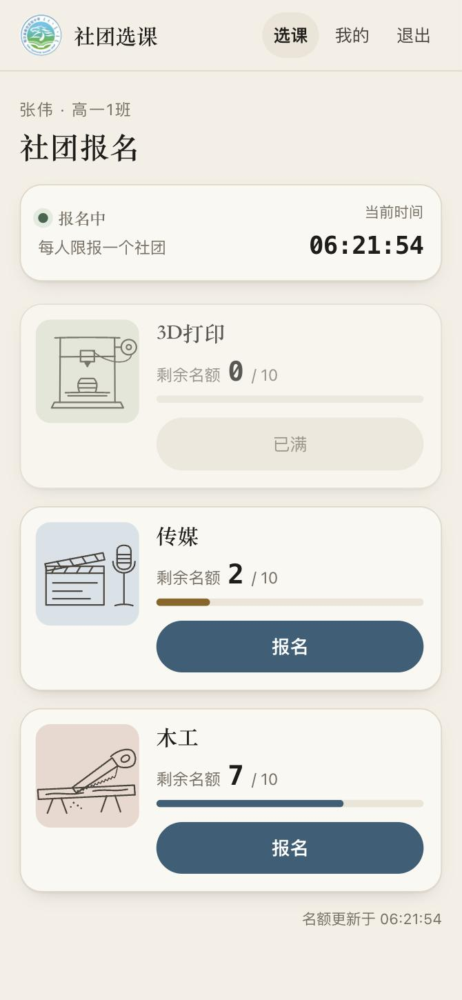

<div align="center">

# 社团选课 · OMMS-STXK

面向中学社团选课的报名系统。开放时间一到，全年级同时报名，每个名额只分给一个人。

[](LICENSE)


<sub>为 <b>鄂尔多斯市实验中学</b> 而做</sub>


</div>

## 功能

**学生端**

- 倒计时与服务器时钟同步，到达开放时间后报名按钮自动亮起。
- 社团卡片展示简介、指导老师、活动时间、地点、面向年级与实时余量。
- 按名称、老师、地点搜索；筛选"我能报名""还有名额""收藏"，收藏的社团排在最前。
- 报名与退选在排队或确认期间自动重试同一请求，结果以服务器为准。

**管理端**

- 从 Excel 粘贴名单，自动识别姓名、班级、学号列，分批创建账号并下载账号密码表。
- 编辑社团名称、容量、简介、老师、时间地点、年级与班级范围、卡片图片，单独开放或暂停某个社团。
- 在学生名单里查找学生，为学生代为报名、调整社团、移出社团或重置密码。
- 设置开放时间，报名结束后一键锁定名单。
- 每次修改写入操作记录，可分别查看管理操作和学生报名。
- 导出报名总表、未报名名单、各社团名册。

**并发与运维**

- 抢位在 Redis 里一步完成；SQLite 容量触发器为每个社团设定最终上限。
- 名额修复以社团为单位进行，其他社团照常报名；Redis 重启后由 SQLite 自动重建。
- 名额快照带 ETag，由 nginx 每秒生成一次，全校轮询集中在一份缓存上。
- 一条命令启动整套服务；只装 Python 的服务器可以单独运行 Python 服务。

<div align="center">
&nbsp;&nbsp;
</div>

## 快速开始

### 开发机：Python + Redis

```bash
pip install redis argon2-cffi pypinyin Pillow
redis-server --port 6379 --save "" --daemonize yes
python3 main.py                     # 打开 http://127.0.0.1:2001
```

`pypinyin` 用于按姓名生成拼音账号，`Pillow` 用于处理社团卡片图片。

首次启动时，日志里输出一次管理员账号和初始密码，登录后请在"设置"里修改。

### 完整部署：nginx + Rust 热路径 + Python 管理服务

```bash
bash run.sh                         # 打开 http://127.0.0.1:8080
```

`run.sh` 适用于 macOS 和 Linux，依次完成以下步骤：

1. 编译 Rust 热服务，启动专用 Redis（`deploy/redis.conf`），生成并校验 nginx 配置。
2. 平滑切换：先等在途报名完成，再启动 Python（:2001）、Rust（:2002）和 nginx（:8080）。

运行文件都放在 `run/` 目录下。再次执行即为平滑重启，`bash run.sh stop` 停止。

服务器只装了 Python 时，`run.sh` 自动切换为只运行 Python 的模式。也可以手动指定：

```bash
OMMS_PYTHON_ONLY=1 bash run.sh
```

### Linux 服务器：systemd

单元文件按仓库位于 `/opt/omms`、以 `omms` 用户运行编写，部署到其他路径时同步修改。

```bash
cp deploy/omms.env.example deploy/omms.env
cargo build --release --manifest-path club-hot/Cargo.toml
sudo cp deploy/systemd/omms-*.service /etc/systemd/system/
sudo systemctl enable --now omms-python omms-hot
```

nginx 使用仓库里的 `nginx.conf`：把 `__APP_ROOT__`、`__RUN_DIR__` 替换为实际路径，再加上 443 端口的 TLS 配置。

## 使用流程

**管理员**（登录页选择"管理员"）

1. **导入学生**：粘贴名单，核对识别出的列后创建账号，在"账号发放"里下载账号密码表，线下发给学生。
2. **添加社团**：批量粘贴"名称，人数上限"，再在社团卡片里补充简介、老师、时间地点和年级范围。
3. **设置开放时间**：按学校时间填写，学生端会显示倒计时。
4. **报名期间**：在"报名数据"里查看各社团进度；学生忘记密码或需要调整时，在"学生名单"里点"管理"处理。
5. **报名结束**：在"设置"里锁定名单，再导出报名总表和各社团名册。

**学生**：用发下来的账号登录，开放前先收藏想去的社团；到点后点"报名"，在"我的社团"里可以退选和改选。每人始终最多报名一个社团。

## 工作原理

```
浏览器 ──▶ nginx :8080 ──┬─ 静态资源、名额快照缓存（1 秒）
                         ├─ 热接口 ──▶ Rust :2002（备用：Python :2001）
                         └─ 管理接口 ──▶ Python :2001
                                  │
                       Redis（名额、会话） + SQLite（报名记录、审计）
```

- **抢位一步完成**：`shared/lua/acquire.lua` 在一个 Redis 脚本里依次检查锁定、维护、开放时间、是否已报名，然后扣减名额、登记租约和在途成员。
- **两层上限**：Redis 负责快速放行；SQLite 触发器 `registrations_capacity_guard` 让落库人数始终在容量以内，`UNIQUE(student_id)` 保证一人一社。
- **只有抢到名额的请求写库**：单写者队列按顺序落库，确认后写入报名镜像；落库结果待确认时按操作代际查库，再决定确认或撤销。
- **按社团修复**：每个社团有在途集合和栅栏。修复时只暂停这个社团，等在途操作完成后，以 SQLite 为准发布库存。失效租约、确认中断、管理端调整都会进入后台修复队列。
- **幂等请求**：前端为每次报名生成 `request_id`。服务端把它和学生 ID 组成操作代际，重试同一请求总能得到同一结果。
- **两个服务，一份协议**：Python 和 Rust 读取同一组 Lua 脚本（`shared/lua`）和提示文案（`shared/messages.json`），共用 Redis 键名和会话格式。

完整设计见 [docs/architecture.md](docs/architecture.md)。

## 配置

两个服务读取相同的环境变量。

| 变量 | 默认值 | 说明 |
|---|---|---|
| `DB_PATH` | `club_system.db` | SQLite 数据库路径 |
| `REDIS_URL` | `redis://127.0.0.1:6379/0` | Redis 地址 |
| `REDIS_PREFIX` | `omms:` | Redis 键前缀，便于与其他应用共用实例 |
| `APP_UTC_OFFSET` | `+08:00` | 学校所在时区，开放时间按此解释 |
| `COOKIE_SECURE` | `0` | 使用 HTTPS 时设为 `1` |
| `SQLITE_SYNCHRONOUS` | `NORMAL` | SQLite 同步级别 |
| `ARGON2_MEMORY_KIB` / `ARGON2_TIME_COST` / `ARGON2_PARALLELISM` | `19456` / `2` / `1` | 口令哈希参数 |
| `AUTH_CONCURRENCY` | CPU 核数（最多 4） | 同时计算口令哈希的数量 |
| `SEAT_OP_TTL` | `30` | 报名租约秒数 |
| `MAX_IMPORT_STUDENTS` | `500` | 每批导入学生上限 |
| `SEATS_CACHE_MS` | `500` | 后端名额快照缓存毫秒数 |
| `REGISTER_WAIT_MS` | `8000` | Rust 报名请求等待结果的时长，超出后返回 `pending` |
| `MAX_CONCURRENCY` | `1024` | Rust 同时处理的请求上限 |

## 学生端接口

| 接口 | 说明 |
|---|---|
| `POST /api/login` | 学生登录，签发会话与受信设备 Cookie |
| `GET /api/catalog` | 社团目录，带 ETag |
| `GET /api/seats` | 名额快照、开放时间与锁定状态，带 ETag |
| `GET /api/check_registration_time` | 服务器时间与开放时间 |
| `POST /api/register_club` | 报名，参数 `club_id`、`request_id` |
| `POST /api/cancel_registration` | 退选 |
| `GET /api/get_student_info` | 个人信息与报名结果 |

响应统一包含 `success`、`code`、`message`：

- 200：业务结果，例如 `registered`、`full`、`not_open`、`registered_other`；
- 202 `pending`：已受理，正在确认；
- 503：繁忙或名额更新中，按 `Retry-After` 用同一个 `request_id` 重试即可。

提示码与文案见 `shared/messages.json`。

## 测试与压测

```bash
cargo build --release --manifest-path club-hot/Cargo.toml
python3 -m unittest discover -s tests -p 'test_*.py' -v
python3 tests/stress_registration.py --seats 100 --users 1000 --concurrency 1000
```

压测在临时 SQLite 和随机端口的私有 Redis 上进行，结束后检查 16 项一致性条件：成功数等于名额、数据库人数、Redis 库存、报名镜像、在途成员与租约。

在一台 Apple Silicon 笔记本上的实测结果：

| 场景 | 吞吐 | p99 |
|---|---|---|
| 1000 名学生同时争抢 100 个名额 | 5828 次/秒 | 109 ms |
| 1000 名学生全部报名成功、全部写库 | 3369 次/秒 | 198 ms |

上线前请在目标服务器上用同样的命令测一次。

## 上线清单

- 开启 HTTPS，两个服务设置 `COOKIE_SECURE=1`。
- Redis 使用 `deploy/redis.conf`，或者为本系统单独分配一个库和键前缀。
- 按学校时区设置 `APP_UTC_OFFSET`。
- 提醒学生提前几分钟登录，让口令校验的计算分散在开放之前。

## 项目结构

```
main.py          Python 管理服务与热接口备用实现（标准库 + SQLite）
club-hot/        Rust 热路径服务（axum + Redis + SQLite）
shared/          两个服务共用的 Lua 脚本与提示文案
web/             前端页面、样式、脚本与插画（原生 HTML、CSS、JS）
nginx.conf       边缘限流、缓存与路由
run.sh           一键启动与平滑重启
deploy/          Redis 配置、环境变量模板、systemd 单元
tests/           隔离的回归测试与压测
docs/            设计说明与截图
```

## 参与贡献

欢迎提交 Pull Request，提交前请阅读 [CONTRIBUTING.md](CONTRIBUTING.md)。

## 作者与许可

由 **BIRI GA（[KeikaJames](https://github.com/KeikaJames)）** 在 **Vles0123** 的原始版本上经授权重写和扩展，以 [Apache-2.0](LICENSE) 分发，署名见 [NOTICE](NOTICE)。
