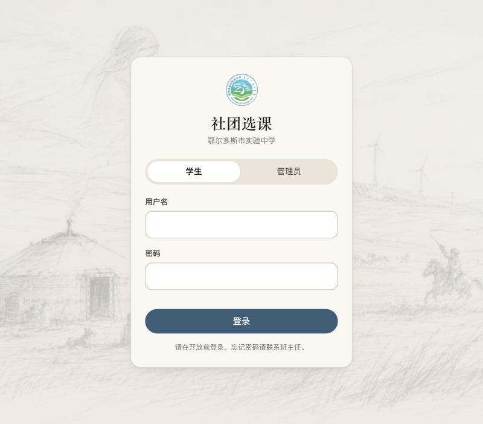

<div align="center">

# 社团选课 · OMMS-STXK

面向中学社团选课的报名系统，支持定时开放、分批报名、锁定后调剂与名单导出。



</div>

<div align="center">
&nbsp;&nbsp;
</div>

## 快速开始

安装步骤见[部署指南](docs/deployment.md)。在 Mac 或 Linux 上，于项目目录运行：

```bash
bash run.sh
```

本机开发方式见[开发与调试](docs/development.md)。

## 功能

管理员导入学生名单、设置社团和报名批次、管理报名并导出结果。学生在开放时段选择社团；名单锁定后，可按剩余名额调剂未报名学生。

## 文档

- [部署指南](docs/deployment.md)
- [系统设计](docs/architecture.md)
- [学生端 API](docs/api.md)
- [开发与调试](docs/development.md)
- [测试方法与实测结果](tests/README.md)
- [MCP 代理运行指南](agent/AGENTS.md)

## 参与贡献

欢迎提交 Pull Request，提交前请阅读 [CONTRIBUTING.md](CONTRIBUTING.md)。

## 作者与许可

由 **BIRI GA（[KeikaJames](https://github.com/KeikaJames)）** 在 **Vles0123** 的原始版本上经授权重写和扩展，以 [Apache-2.0](LICENSE) 分发，署名见 [NOTICE](NOTICE)。
